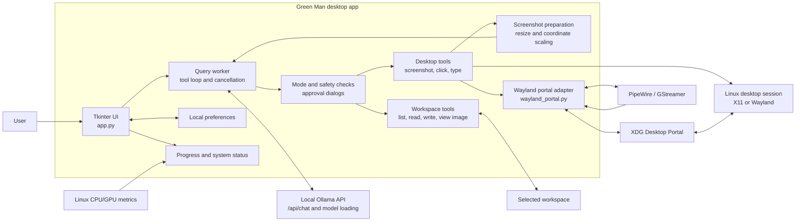

# Local LLM Desktop Assistant

A small Linux desktop app that connects to a local Ollama server and can inspect
the screen, interact with desktop applications, read and write files in a chosen
folder, and run shell commands.

## Architecture



The UI starts each query on a worker thread and sends the conversation to the
local Ollama API. Any tool request is checked against the selected assistant
mode; actions that can change the desktop or files wait for user approval.
Workspace tools are confined to the selected folder. Desktop screenshots are
prepared before being sent back to the model, and click coordinates are mapped
from the prepared image to the original screen size. On Wayland, desktop access
uses the XDG Desktop Portal and PipeWire; on other Linux sessions, the app uses
PyAutoGUI. Preferences stay local to the app, and CPU/GPU readings feed the
working status line.

## Requirements

- Python 3.10 or newer with Tkinter
- Ollama running locally with a vision model that supports tool calling
- A Linux graphical session. Wayland sessions use the XDG Desktop Portal and
  PipeWire; on Ubuntu install `gstreamer1.0-tools`, `gstreamer1.0-pipewire`,
  `gstreamer1.0-plugins-good`, and `pipewire-bin` if they are not already
  installed. The first screen access opens a desktop permission dialog.

## Run

```sh
python3 -m venv .venv
. .venv/bin/activate
python -m pip install -r requirements.txt
ollama pull qwen3-vl:8b
ollama pull llama3.1:8b
python app.py
```

The app defaults to `llama3.1:8b`. To enable screenshot understanding, also
download the vision model:

```sh
ollama pull qwen3-vl:8b
```

The app window uses a green theme with light backgrounds and readable text.
The window icon is loaded from `greenMan.png` in the project directory. Desktop
environments that hide icons in window decorations still show the logo in the
app header.

Choose either model from the **Ollama model** dropdown. Changing the selection
loads the chosen model into Ollama; once loaded, it is used for new requests and
the conversation starts fresh.

Choose an existing workspace folder before sending a message. The Send button
stays disabled until a valid folder is selected.

The app remembers the last selected workspace, assistant mode, and model between
runs. If the saved workspace no longer exists, it starts with no folder selected
and keeps Send disabled until you choose a valid folder.

Drop a PNG, JPEG, or WebP image onto the message box to attach it to your next
question. Images up to 10 MB are supported; select `qwen3-vl:8b` for image
understanding. The dropped image is sent with your text directly to the
configured local Ollama server, and does not need to be inside the workspace.

Press Enter once in the message box to add a newline. Press Enter again within
one second, without typing another key, to send the message.

While the assistant is working, the status line shows CPU temperature and CPU
and GPU utilization. CPU utilization is calculated from Linux `/proc/stat`
counters, so it appears after the second status update. NVIDIA GPU utilization
is read with `nvidia-smi`; AMD/Intel utilization is read from Linux sysfs when
exposed by the driver. Unavailable readings are shown as `N/A`.
An animated green progress indicator appears while the assistant is processing
and stops when the response completes. During a query, the Send button becomes
a red **Stop** button; using it closes the active Ollama response and prevents
further tool actions for that query.
Qwen tool requests use a shorter generation budget to reduce delays before
desktop and workspace actions; image-analysis requests retain a larger budget.

When a query or task finishes, its elapsed time is added to the conversation
history, including time spent on tool actions and approvals.

On Wayland, approve the portal prompt and select the monitor the assistant may
capture and control. Keep the selected screen available while the app is running.
If screenshot capture times out, check that the screen-sharing permission is
still active and the selected monitor is available. The app includes GStreamer
output in the timeout message to help diagnose PipeWire capture failures.
`pipewire-bin` provides `pw-cli`, which the app uses when an older desktop
portal does not return the PipeWire stream serial.

File tools are restricted to the selected workspace folder. In **Workspace
files** mode, the assistant can inspect PNG, JPEG, and WebP images up to 10 MB;
image understanding requires selecting `qwen3-vl:8b`. The model and API URL can
be changed in the app; the URL is restricted to localhost.

Select an assistant mode before sending a request. **Questions only** is the
default and sends no tools to the model. **Screenshot**, **Desktop control**,
**Workspace files**, and **Run command** each expose only their corresponding
tools. Desktop control also enables screenshots so the assistant can inspect the
screen before clicking or typing.

## Safety and privacy

- Typing, clicking, writing files, and running shell commands each show the
  exact proposed arguments in a confirmation dialog. In a click or typing
  confirmation, select **Remember my approval for desktop actions until the app
  closes** to skip later desktop-action prompts for the rest of this app run.
  This does not apply to file writes or shell commands, which continue to ask
  for approval every time. Denying an action prevents it from running.
- File reads and writes are limited to the selected workspace. Reads are capped
  at 1 MB; writes do not create missing parent directories.
- Commands run in the selected workspace (or your home folder if none is
  selected), with a 30-second timeout. This is **not a security sandbox**:
  an approved command can still access or change other parts of your system.
- Screenshots and prompts are sent to the configured Ollama server. The app
  only allows a local URL, but other software or extensions on your computer
  may still access local services.
- Review each confirmation carefully. A local model can make mistakes or be
  misled by content it sees on screen or reads from files.

Run the focused tests with:

```sh
python3 -m unittest
```
