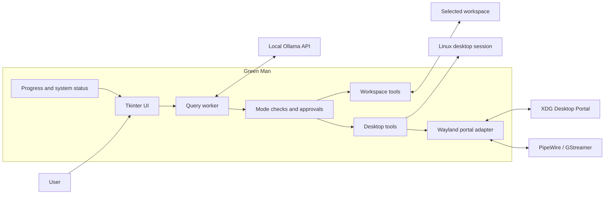
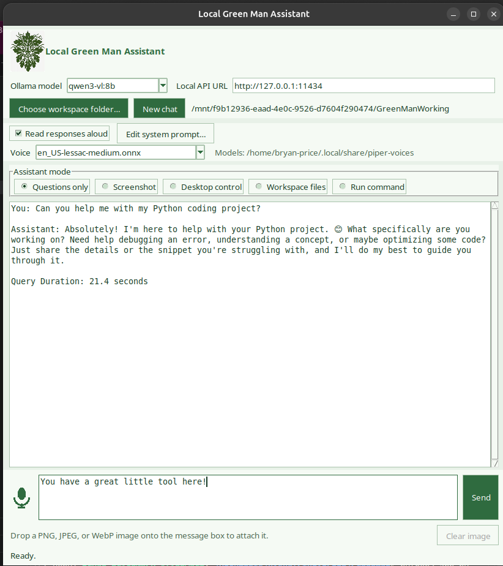

# Green Man


Green Man is a local Linux desktop assistant that connects to a local Ollama server and helps you interact with your desktop, files, and applications through a simple graphical interface.

It is designed for privacy-conscious, local-first workflows. The assistant runs on your machine, keeps file access inside a selected workspace, and requires explicit approval before desktop actions, file writes, or shell commands are executed.

## Features

- Local chat with Ollama
- Screenshot capture for desktop inspection
- User-approved desktop control for clicks and typing
- Workspace-scoped file and image access
- Read, write, and inspect files within a chosen folder
- Run shell commands with explicit approval
- Optional spoken assistant responses
- Editable, persistent system prompt
- Support for both X11 and Wayland sessions
- Persistent local preferences for model, mode, workspace, and voice setting

## Architecture




## Screen Shot




## Requirements

- Python 3.10 or newer
- Tkinter
- A local Ollama server
- A Linux graphical session
- A model that supports both vision and tool calling for image and desktop workflows
- Microphone dictation uses Vosk and the default English speech model (setup below)

Qwen3-VL requires Ollama 0.12.7 or newer. Check the installed version with
`ollama --version` and update Ollama only if it is older than that; restart the
Ollama server after updating.

### Wayland Requirements

On Wayland, Green Man uses the XDG Desktop Portal and PipeWire. If needed, install the required packages on Ubuntu:

```bash
sudo apt install gstreamer1.0-tools gstreamer1.0-pipewire gstreamer1.0-plugins-good pipewire-bin
```

For basic spoken responses, install `espeak-ng` or Speech Dispatcher:

```bash
sudo apt install espeak-ng
# Alternatively:
sudo apt install speech-dispatcher
```

For more natural, local neural speech, install Piper into Green Man's virtual
environment. Run these commands from the project folder after completing the
Quick Start setup; using `python3 -m pip` outside the virtual environment may fail
on Debian/Ubuntu with an externally-managed-environment error:

```bash
.venv/bin/python -m pip install piper-tts
```

Download one or more Piper `.onnx` voice models and their matching `.onnx.json`
configuration files with Piper's downloader. For example:

```bash
mkdir -p ~/.local/share/piper-voices
.venv/bin/python -m piper.download_voices en_US-lessac-medium \
  --data-dir ~/.local/share/piper-voices
```

Models are stored in `~/.local/share/piper-voices/`. Green Man lists the `.onnx`
files in that folder in its **Voice** dropdown, with **System voice** as the first
and default choice. The list refreshes when you open the dropdown. Launch Green Man
with that same environment so it can find Piper:

```bash
.venv/bin/python app.py
```

Browse [Piper voice models](https://huggingface.co/rhasspy/piper-voices) and
check the selected voice's license before using it. Green Man does not download
voice models automatically. Install an audio player (`pw-play`, `paplay`, `aplay`,
or `ffplay`) to play the generated speech. See Piper's
[CLI documentation](https://github.com/OHF-Voice/piper1-gpl/blob/main/docs/CLI.md)
for additional options.

## Quick Start

```bash
git clone https://github.com/bryanspms/GreenMan.git
cd GreenMan
python3 -m venv .venv
. .venv/bin/activate
python -m pip install -r requirements.txt
ollama pull llama3.1:8b
ollama pull qwen3-vl:8b-instruct
python app.py
```

The default model is `llama3.1:8b`. Use a Qwen3-VL `-instruct` model for image
understanding and desktop control. The regular Qwen3-VL tags are thinking
variants; Ollama's API `think: false` setting does not disable their thinking.
If the 8B model is too slow, pull the smaller, typically faster 4B instruct model:

```bash
ollama pull qwen3-vl:4b-instruct
```

## GNOME Wayland Window Control (optional)

On GNOME Wayland, apps cannot be focused through accessibility, so closing or
activating a window by title needs a small shell extension. Install it, then log
out and back in once:

```bash
cp -r gnome_extension/greenman-windows@greenman.local ~/.local/share/gnome-shell/extensions/
gnome-extensions enable greenman-windows@greenman.local
```

When the extension is running, Green Man uses it to close or activate the window
with the approved exact title. Without it, Green Man falls back to the
accessibility and keyboard-shortcut path.

## Microphone Dictation

The microphone button beside the message field starts live, offline English
dictation. Click it again to stop; recognized phrases are added to the message
field as you speak. Audio is processed locally by Vosk.

Install the Python dependencies from the project folder:

```bash
.venv/bin/python -m pip install -r requirements.txt
sudo apt install libportaudio2 unzip
```

Download and extract the default small English model:

```bash
mkdir -p ~/.local/share
cd ~/.local/share
wget https://alphacephei.com/vosk/models/vosk-model-small-en-us-0.15.zip
unzip -q vosk-model-small-en-us-0.15.zip
rm vosk-model-small-en-us-0.15.zip
```

The app looks for the extracted model at
`~/.local/share/vosk-model-small-en-us-0.15`. Other languages can be used by
downloading a Vosk model and placing its extracted folder at that path.

## Usage

1. Choose a workspace folder.
2. Select an assistant mode:
   - Questions only
   - Screenshot
   - Desktop control
     On Wayland, **Screenshot** requests screen-capture access only; **Desktop
     control** also requests pointer and keyboard access.
     Use **list_windows** to locate windows by application and title, including
     windows behind Green Man. Use **activate_window** to bring one forward,
     **close_named_window** to close it, and **list_applications** /
     **launch_application** to open an installed desktop app. Green Man shows the
     resolved window or app in its approval dialog before activation, closing, or
     launch. For controls inside a window, activate it first, then use the fresh
     screenshot for clicks and typing. A close request is verified by checking
     whether the title is still in the accessible window list; that does not prove
     the entire application process has exited. Screenshots after visual clicks
     and typing are saved to
     `~/.cache/greenman/last-desktop-verification.jpg`; desktop screenshots may
     contain private information.

     ```mermaid
     flowchart TD
         A[Request to open, find, interact with, or close an app] --> B{Requested action}
         B -- Open --> C[list_applications]
         C --> D[Select installed app]
         D --> E[Approve launch in Green Man]
         E --> F[launch_application]
         F --> G[list_windows to verify]
         B -- Find, interact, or close --> H[list_windows]
         H --> I[Match application and window title]
         I --> J{Requested action}
         J -- Close --> K[Approve exact window title]
         K --> L[Activate that window and send close shortcut]
         L --> M[list_windows to verify]
         J -- Interact --> N[Approve and activate window]
         N --> O[Capture fresh screenshot]
         O --> P[Approve visual click or typing]
         P --> Q[Inspect verification screenshot]
     ```
   - Workspace files
   - Run command
3. Choose the Ollama model.
   Green Man checks its Ollama capabilities and disables **Screenshot** and
   **Desktop control** unless the model supports both vision and tool calling.
   The **view_image** tool in **Workspace files** is omitted for models without
   vision.
4. Optionally enable **Read responses aloud** and choose **System voice** or an
   installed Piper voice from the **Voice** dropdown.
5. Use **Edit system prompt…** beside the read-aloud checkbox to customize the
   instructions sent to the model. Saving applies the prompt to the current chat
   and future chats, and stores it in local preferences.
6. Send your request.

To dictate, click the microphone icon to start listening, speak, then click it
again to stop. Review or edit the recognized text before sending.

Spoken responses are disabled by default. The voice selection is saved with your
local preferences. **System voice** uses `espeak-ng`, `espeak`, or `spd-say` from
Speech Dispatcher.

The assistant will prompt for approval before performing desktop actions, writing files, or running shell commands.

## Safety and Privacy

Green Man includes safeguards to keep operations transparent and controlled:

- File access is limited to the selected workspace
- File writes require approval
- Desktop interactions require approval
- Shell commands require approval
- Screenshots and prompt data are sent only to the configured local Ollama instance
- The app only allows local Ollama URLs

This is not a sandbox. Approved commands can still affect other parts of the system if the user explicitly allows them.

## Testing

```bash
python3 -m unittest
```

## Contributing

Contributions are welcome. Please open a pull request with a clear explanation of the change and its purpose.


## License
Green Man is licensed under the MIT License.

You are free to use, modify, distribute, and incorporate portions of the project for both commercial and non-commercial purposes, provided proper attribution is maintained and the original copyright notice is preserved.

Copyright (c) 2026 Bryan Price


## Attribution

If you build upon Green Man, attribution is appreciated: "Based on GreenMan  (github.com/bryanspms/GreenMan) by Bryan Price"