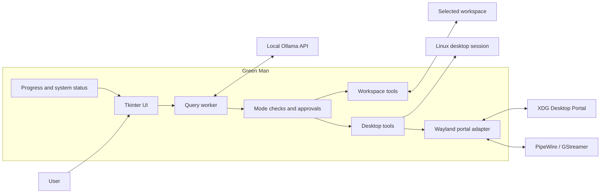

# Green Man

Green Man is a local Linux desktop assistant that connects to a local Ollama server and helps you interact with your desktop, files, and applications through a simple graphical interface.

It is designed for privacy-conscious, local-first workflows. The assistant runs on your machine, keeps file access inside a selected workspace, and requires explicit approval before desktop actions, file writes, or shell commands are executed.

## Features

- Local chat with Ollama
- Screenshot capture for desktop inspection
- User-approved desktop control for clicks and typing
- Workspace-scoped file and image access
- Read, write, and inspect files within a chosen folder
- Run shell commands with explicit approval
- Support for both X11 and Wayland sessions
- Persistent local preferences for model, mode, and workspace

## Architecture



## Requirements

- Python 3.10 or newer
- Tkinter
- A local Ollama server
- A Linux graphical session
- A model that supports both vision and tool calling for image and desktop workflows

### Wayland Requirements

On Wayland, Green Man uses the XDG Desktop Portal and PipeWire. If needed, install the required packages on Ubuntu:

```bash
sudo apt install gstreamer1.0-tools gstreamer1.0-pipewire gstreamer1.0-plugins-good pipewire-bin
```

## Quick Start

```bash
git clone https://github.com/bryanspms/GreenMan.git
cd GreenMan
python3 -m venv .venv
. .venv/bin/activate
python -m pip install -r requirements.txt
ollama pull llama3.1:8b
ollama pull qwen3-vl:8b
python app.py
```

The default model is `llama3.1:8b`. Use `qwen3-vl:8b` for image understanding and multimodal tasks.

## Usage

1. Choose a workspace folder.
2. Select an assistant mode:
   - Questions only
   - Screenshot
   - Desktop control
   - Workspace files
   - Run command
3. Choose the Ollama model.
4. Send your request.

The assistant will prompt for approval before performing desktop actions, writing files, or running shell commands.

## Safety and Privacy

Green Man includes safeguards to keep operations transparent and controlled:

- File access is limited to the selected workspace
- File writes require approval
- Desktop interactions require approval
- Shell commands require approval
- Screenshots and prompt data are sent only to the configured local Ollama instance
- The app only allows local Ollama URLs

This is not a sandbox. Approved commands can still affect other parts of the system if the user explicitly allows them.

## Testing

```bash
python3 -m unittest
```

## Contributing

Contributions are welcome. Please open a pull request with a clear explanation of the change and its purpose.

## License

This project is provided as-is for personal and research use. Please review the repository and applicable licensing details before reusing it in production or distributed environments.